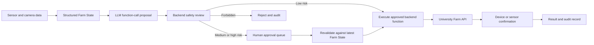

# ADR-0002: AI Control and Safety Flow (Personal Draft)

- Status: Personal discussion draft; not yet approved by the team
- Date: 2026-07-26
- Last updated: 2026-07-31
- Scope: LLM function calling, risk control, approval queue and Farm execution

## 1. Project integration goal

The final system should connect to the subset of University Farm interfaces that the project owner makes available and authorises for this project. Unsupported, read-only or unapproved capabilities remain monitoring-only, recommendation-only or simulator-only rather than being treated as controllable devices.

The LLM cannot call the Farm API directly. It can only request backend functions that have been predefined, typed and placed on an allow-list.

The project-owner-provided hardware diagram describes the farm's approximate physical layout and possible JSON telemetry, outlet-status and outlet-control surfaces. It is not the final API contract and does not itself grant write access. Camera placement is configurable, and the illustrated fans operate together as one control group; no per-level camera, fan or light API should be assumed without separate confirmation.

## 2. Core processing flow



## 3. API capability and permission gate

Before exposing a backend function, the team must confirm and record:

- the actual endpoint and schema;
- whether project access is unavailable, read-only or read/write;
- authentication and authorisation requirements;
- the physical device and control group mapped to the endpoint;
- operating limits, cooldowns and approval requirements;
- acknowledgement, feedback and failure behaviour;
- whether a safe test environment or simulator is available.

Only endpoints in this owner-confirmed capability and permission matrix may be registered as executable backend functions. A control shown on a sample Dashboard is not evidence that the team is permitted to call it.

## 4. LLM function calls

The backend exposes only fixed, allow-listed functions for confirmed capabilities. Illustrative domain-level functions could include:

- `set_lighting(control_group, state, duration)`
- `set_fans(control_group, state, duration)`
- `run_irrigation(duration)`
- `dose_nutrient(type, amount)`
- `update_growing_plan(...)`

These examples are not claims that corresponding writable Farm API endpoints exist. `control_group` must come from the confirmed hardware mapping; for example, the current illustration shows both fans as one simultaneous group and lighting as one shared outlet rather than per-level controls.

The LLM may select a function and propose structured parameters. It must not:

- call the Farm API directly;
- create new function names;
- generate executable code, URLs or arbitrary API requests;
- decide by itself that a request is safe to execute.

The LLM may provide a suggested risk level, but the backend safety layer independently calculates the authoritative risk from the function, parameters, current Farm State and approved limits. If the two assessments differ, the safer classification is used.

## 5. Risk model

| Risk result | Behaviour |
|---|---|
| Low risk | The backend may execute automatically after safety validation. |
| Medium/high risk | The operation enters the human approval queue. |
| Forbidden | The operation is rejected; neither the LLM nor an administrator can approve it. |

Risk depends on both the operation type and its quantity. Examples include fan runtime, irrigation duration, dosing amount and cumulative activity.

The approved limits must come from the Farm owner and Biology/domain reviewers. They must not be invented by the LLM.

## 6. Qualitative and quantitative risk

Two forms of high risk are distinguished:

- **Qualitative risk:** the operation itself is considered high risk. It cannot be divided into smaller automatic operations; it must be approved, cancelled or replaced.
- **Quantitative risk:** the operation becomes high risk because its amount, duration or intensity is too high for automatic execution.

A quantitatively high-risk operation may have a separate low-risk fallback. This is a downgrade, not a decomposition:

- the fallback is one independent action with a lower total quantity;
- the safety layer validates it independently;
- single-action and rolling-window cumulative limits still apply;
- repeated low-risk actions must not be used to reproduce the original high-risk total;
- after the fallback executes, the system must wait for a new sensor data batch and rebuild the Farm State before proposing another action;
- execution of the fallback supersedes or forces re-evaluation of the original high-risk proposal.

## 7. Approval queue and proposal versioning

Queued operations are immutable audit records. The LLM cannot silently edit an item that a person may already be reviewing.

On a later analysis cycle, the pending queue is included in the structured context. The LLM may propose:

- `KEEP`: retain the existing proposal;
- `CANCEL`: cancel the existing proposal;
- `SUPERSEDE`: create a new proposal that replaces it.

A replacement receives a new version and passes through the complete safety process again. The previous version remains available in the audit history.

An approval does not immediately authorise the stored parameters. Before execution, the backend must load the latest Farm State and re-run safety validation. An expired or newly unsafe proposal is rejected and must be regenerated.

If a high-risk proposal is not approved, it remains pending until it is cancelled, superseded or expires. It never becomes automatically executable merely because it has waited for a long time.

## 8. Analysis timing and immediate safety

The final camera format and sensor sampling interval are not yet known. The analysis interval should therefore be configurable and normally follow the completed data-acquisition batch. For example, if a complete batch arrives every 15 minutes, the overall Farm State and LLM analysis can update every 15 minutes.

Critical safety protection must not depend on LLM availability or the normal analysis interval. Backend safety monitoring may immediately execute only fail-safe stop/disable actions when a hard limit is crossed, such as stopping dosing or irrigation. It must not automatically add water, nutrients or perform another active corrective treatment.

## 9. Execution lifecycle

A successful Farm API response does not prove that the physical device performed the action. Execution should use states such as:

```text
REQUESTED
  -> SAFETY_CHECKED
  -> SENT
  -> ACKNOWLEDGED
  -> CONFIRMED | FAILED | TIMEOUT
```

An operation becomes `CONFIRMED` only after device feedback or subsequent sensor evidence verifies the expected effect.

## 10. Farm State and CV quality

The LLM receives a compact, structured Farm State rather than every raw record or image. It should include:

- current sensor values and time-window trends;
- data freshness and quality flags;
- structured CV observations and confidence;
- current growing stage and plan;
- pending approval items and versions;
- recent executions and verified outcomes;
- the currently available function allow-list.

Raw sensor data and images remain stored for traceability and later investigation.

Low-confidence, blurred or unavailable CV evidence is represented as `UNKNOWN`. Operations that depend on that evidence cannot execute automatically. If sensor and CV evidence conflict, the Farm State is marked `EVIDENCE_CONFLICT`; the LLM may explain the conflict, but the system follows a conservative action policy until new evidence or human inspection resolves it.

## 11. Initial account model

The MVP prioritises one administrator account. Detailed Viewer, Operator, Approver and Admin role separation is deferred for later team discussion. This simplification does not permit the administrator to bypass forbidden limits or the deterministic safety layer.

## 12. Safety invariants

The following conditions should remain true in every implementation:

1. No LLM output reaches the Farm API without backend safety validation.
2. The safety layer, not the LLM, owns the final risk classification.
3. Medium/high-risk actions do not execute without valid human approval.
4. Forbidden actions cannot be approved.
5. Approval is followed by validation against the latest Farm State.
6. Queued proposals are versioned rather than edited in place.
7. Quantitative downgrade cannot become hidden high-risk decomposition.
8. A downgrade is followed by fresh sensor evidence before another action.
9. Poor-quality CV evidence is not promoted to a trusted fact.
10. A sent command is not recorded as completed until execution is confirmed.
11. An illustrated hardware control is not executable unless its endpoint and project permission are confirmed.
12. Function targets and control groups cannot be more granular than the verified physical/API mapping.

## 13. Items still to confirm

- Farm API contracts, authentication, per-endpoint read/write permission and device feedback mechanisms.
- Which of Pump, Lights, Fans and Doser the project may control, monitor only or simulate.
- Physical device-to-outlet mapping and control grouping, including whether lights or fans have any capability beyond the shared groups shown in the hardware diagram.
- Camera count, configurable positions, field of view, format, capture frequency and image storage requirements.
- Sensor sampling and complete-batch frequency.
- Farm-owner-approved limits, cumulative windows and cooldowns.
- Which operation types are qualitatively high risk.
- Approval expiry time and administrator notification method.
- Whether the final release requires multiple roles or more than one approver.
- Exact rules for resolving sensor/CV evidence conflicts.
