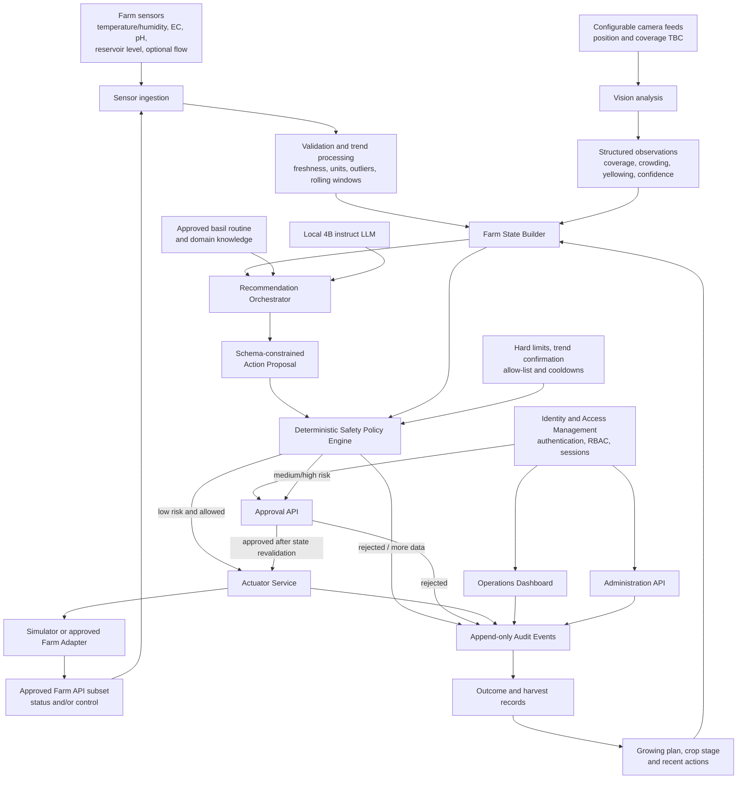

# Leafy AI System Architecture

- Status: Proposed target architecture
- Scope: Semester MVP and safe path to physical-farm integration
- Last updated: 2026-07-31

## Architecture principles

1. Computer vision and sensors provide evidence; they do not directly control hardware.
2. The LLM proposes and explains an action; it does not authorise or execute it.
3. The backend constructs the trusted farm state and makes the final execution decision.
4. Deterministic policy rules and human approval protect medium- and high-risk actions.
5. Authentication, server-side authorisation and auditability apply to every sensitive operation.
6. A hardware or Dashboard diagram documents possible farm capabilities; it does not grant API access or control permission.
7. Physical actuators remain behind an adapter and disabled until the exact endpoint, access mode and integration are approved by the project owner.

## High-level architecture



## Hardware and API boundary

The project-owner-provided farm diagram is an illustrative description of the NFT farm, its physical connections and possible JSON telemetry, outlet-status and outlet-control surfaces. It is not the final Farm API contract and does not mean that every illustrated control is available to the project.

The illustrated hardware baseline currently shows:

- a shared reservoir and main recirculation pump for the NFT channels;
- temperature, humidity, pH, EC and reservoir-level telemetry, with flow monitoring marked optional;
- Pump, Lights, Fans and Doser represented as four power outlets;
- both farm fans operating together as one control group;
- lighting represented as one shared outlet rather than confirmed per-level control;
- camera placement and field of view remaining configurable for the experiment.

Before an integration is enabled, the team must maintain an owner-confirmed capability and permission matrix:

| Interface | Questions that must be confirmed |
|---|---|
| Sensor telemetry | Endpoint, schema, units, sampling frequency, freshness and read permission |
| Outlet status | Device-to-outlet mapping, status semantics, feedback reliability and read permission |
| Outlet control | Writable endpoint, authentication, project authorisation, control grouping, limits and acknowledgement |
| Camera feed | Camera count, position, coverage, format, capture frequency, storage and data-handling permission |

An interface may therefore be `monitoring-only`, `recommendation-only`, `simulator-only`, `approval-required` or eligible for tested low-risk automation. The backend registers executable functions only for the approved subset. UI controls and model schemas must not imply finer control granularity than the confirmed Farm API provides.

## Component responsibilities

### 1. Sensor ingestion and trend processing

The backend validates units, timestamps, freshness and plausible ranges before data becomes part of the trusted farm state. It computes rolling statistics and trends rather than asking the LLM to interpret raw time-series data.

Invalid, stale or insufficient readings produce an `UNKNOWN` or `MORE_DATA_REQUIRED` state. A single reading must not authorise a medium- or high-risk action.

### 2. Vision analysis

The initial vision baseline should use simple image processing or an approved pretrained model. Fine-tuning is optional and requires a labelled local dataset and a demonstrated baseline failure.

The vision boundary returns structured observations rather than free-form text, for example:

```json
{
  "canopyCoverage": 0.72,
  "crowding": "high",
  "yellowing": "moderate",
  "confidence": 0.84,
  "imageQuality": "good",
  "requiresHumanReview": false
}
```

Low-confidence or poor-quality results are not promoted to facts. They are marked unknown or routed to human inspection.

### 3. Farm State Builder

The Farm State Builder combines:

- validated sensor values and trends;
- vision observations and confidence;
- crop stage and approved growing plan;
- recent recommendations and executed actions;
- data-quality and freshness flags.

This component owns evidence gating and conflict detection. It does not delegate basic arithmetic, freshness checks or confidence thresholds to the LLM.

### 4. Recommendation Orchestrator and LLM

The target baseline is a local 4B instruction-following model behind a provider-neutral adapter. A hosted model may be evaluated only if the project owner approves data residency, licensing and cost.

The model receives a compact farm state, relevant routine excerpts and an explicit action allow-list. Constrained decoding or a JSON grammar produces a typed action proposal. The model may recommend and explain, but it cannot call a farm adapter directly.

Example proposal:

```json
{
  "action": "INCREASE_FAN",
  "parameters": {
    "level": 2,
    "durationMinutes": 15
  },
  "reason": "Temperature is rising while canopy crowding is high.",
  "evidence": [
    "temperatureTrend=rising",
    "canopyCoverage=0.72"
  ],
  "riskLevel": "low",
  "confidence": 0.82,
  "requiresHumanApproval": false
}
```

Schema validity does not prove agronomic correctness or safety. Invalid proposals are never executed; one bounded repair attempt may be made before routing the case to a human.

### 5. Deterministic Safety Policy Engine

The policy engine is the final automated authority. It verifies:

- action and parameter allow-lists;
- hard operating limits;
- data freshness and minimum sample counts;
- required trend confirmation;
- device state and cooldown periods;
- vision-confidence thresholds where vision evidence is required;
- action risk and approval requirements.

Its result is one of:

```text
ALLOWED
REJECTED
MORE_DATA_REQUIRED
HUMAN_APPROVAL_REQUIRED
```

Irrigation and dosing require human approval during the initial project phase. Low-risk light and fan actions may become automatic only after testing and project-owner approval.

### 6. Approval and execution

Approval is a server-side state transition, not a frontend-only button. Immediately before execution, the backend revalidates:

- the approver's current role;
- the recommendation and policy decision;
- the latest farm state;
- expiry and prior-use status of the approval;
- idempotency of the requested action.

An approval cannot be reused after the underlying state has materially changed. The actuator service maps an approved action enum to a simulator or to an endpoint present in the owner-confirmed capability and permission matrix; it does not execute model-generated code, arbitrary function names or an unapproved illustrated control.

## Identity and account security

### Identity strategy

The preferred production identity source is a university-approved SSO/OIDC provider. The team should not build a custom identity platform if an approved provider is available.

The current feasibility baseline uses a server-side demo identity on localhost and requires the workspace identity header for deployed writes. This is not the final production authentication design.

### Roles and separation of duties

| Role | Permitted responsibilities |
|---|---|
| Viewer | Read current state, recommendations and audit history |
| Operator | Acknowledge alerts, request inspection and initiate permitted low-risk operations |
| Approver | Approve or reject medium- and high-risk proposals after reviewing evidence |
| Admin | Manage users, roles, configuration and integrations |
| AI Service | Submit recommendations only; cannot approve or execute actions |
| Actuator Service | Execute a policy-authorised action through an adapter; cannot create or approve recommendations |

All permissions are enforced by backend APIs. Hiding a Dashboard button is not an authorisation control.

The AI Service must never hold approval, administration or actuator credentials. Where practical, the person who changes a hard safety limit should not be the sole approver of an action affected by that change.

### Session and credential controls

The deployed design must include:

- HTTPS for all browser and service traffic;
- secure, HttpOnly and SameSite cookies when cookie sessions are used;
- CSRF protection for state-changing cookie-authenticated requests;
- bounded session lifetime, logout and server-side revocation;
- login rate limiting and failed-login monitoring;
- MFA for Admin and Approver accounts where supported;
- no passwords, tokens or secrets in URLs, logs or the repository;
- separate credentials and least privilege for the Farm API, database and model service;
- deployment secrets supplied by the approved hosting platform.

Sensitive operations such as changing safety limits, enabling physical automation, changing roles or approving dosing should require recent authentication and may require a second confirmation.

### Service-to-service security

Browser identity and service identity are separate. The backend, AI service and actuator service use distinct credentials and permissions. Farm API credentials are available only to the actuator boundary, not to the browser or LLM process.

Requests include a correlation ID, authenticated principal, timestamp and idempotency key. Replayed, expired or duplicate execution requests are rejected.

## Audit and accountability

Every recommendation and sensitive user action produces an append-only audit event containing:

- correlation and decision identifiers;
- authenticated user or service principal;
- role used for the operation;
- input farm-state snapshot and data-quality flags;
- model, prompt, routine and policy versions;
- raw and parsed recommendation;
- schema and safety-validation results;
- approval, rejection or override reason;
- executed adapter, parameters and result;
- timestamps and error information.

The main decision lifecycle is:

```text
PROPOSED
  -> SCHEMA_VALIDATED
  -> SAFETY_VALIDATED
  -> APPROVAL_PENDING (when required)
  -> EXECUTING
  -> EXECUTED | REJECTED | FAILED | EXPIRED
```

Ordinary users cannot alter or delete audit records. Logs must not contain passwords, session tokens, API keys or unnecessary personal information.

## Trust boundaries

1. **Browser boundary:** all browser input is untrusted and revalidated server-side.
2. **Model boundary:** all LLM and vision output is untrusted until schema and policy validation pass.
3. **Farm boundary:** physical commands require authenticated, authorised and idempotent actuator requests.
4. **External-provider boundary:** farm data cannot leave the approved environment without a documented data-handling decision.
5. **Administration boundary:** role, policy and integration changes require elevated privileges and audit events.

## Current baseline versus target

| Area | Current feasibility baseline | Target before physical integration |
|---|---|---|
| Farm execution | Simulator only | Approved authenticated Farm adapter for the confirmed API subset |
| Identity | Local demo identity / workspace identity header | Approved SSO/OIDC and lifecycle management |
| Authorisation | Authenticated approval route | Full server-side RBAC across all sensitive routes |
| LLM and vision | Adapter boundaries | Evaluated providers with schema-constrained outputs |
| Safety | Deterministic policy tests | Owner-approved ranges, failure tests and Biology/Cybersecurity review |
| Audit | Persistent domain audit events | Access-controlled, append-only operational audit trail |
| Secrets | No physical credentials required | Hosting-platform secrets and credential rotation |

## Deferred items

- custom model training and LLM fine-tuning;
- reinforcement learning and autonomous online exploration;
- automatic dosing without approval;
- custom password-based identity platform when SSO is available;
- behavioural anomaly detection and two-person approval, unless required by the threat model;
- physical hardware enablement before owner acceptance.

## Open architecture decisions

- Confirm the Farm API authentication and command contract, including which illustrated endpoints are read-only or read/write for this project.
- Confirm the device-to-outlet mapping and actual control groups for Pump, Lights, Fans and Doser; do not assume per-level light or fan control.
- Confirm camera count, configurable positions, coverage, capture frequency and image-storage requirements.
- Confirm the university identity provider and available roles/groups.
- Confirm whether any farm image or sensor data may reach an external model provider.
- Confirm approved operating ranges, trend windows and action cooldowns.
- Define role assignment, account lifecycle and emergency-access procedure.
- Define audit-log retention, access and export requirements.
- Define the acceptance thresholds for vision confidence and LLM recommendations.
